

  <b>Vibe Coder</b> &nbsp;•&nbsp; <b>AI-Assisted Developer</b> &nbsp;•&nbsp; <b>UI/UX Enthusiast</b>

  
  
  


  

Halo, saya **Zycho** (`zychocuwek`), seorang *vibe coder* yang membangun produk digital bersama AI. Saya senang mengubah ide mentah menjadi sesuatu yang benar-benar bisa dipakai: cepat dalam bereksperimen, rapi dalam eksekusi, dan selalu memperhatikan pengalaman pengguna.


  

| Tahap | Yang saya lakukan |
|:--|:--|
| 💡 **Idea** | Menentukan masalah yang ingin diselesaikan dan gambaran hasil akhirnya. |
| ⌨️ **Prompt** | Menjabarkan kebutuhan secara jelas dan terstruktur untuk AI. |
| 🤖 **AI** | Memakai AI sebagai partner untuk menyusun kode, desain, dan solusi. |
| ✨ **Vibe** | Mengiterasi dan memoles sampai tampilan serta alurnya terasa pas. |
| 🚀 **Ship** | Menguji, merapikan, lalu merilis produk yang siap dipakai. |

  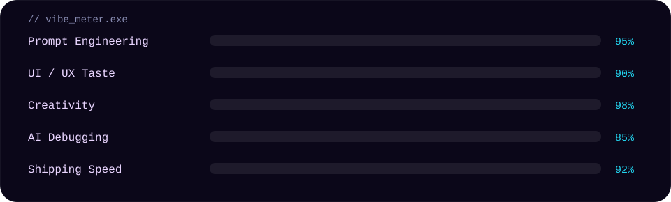


  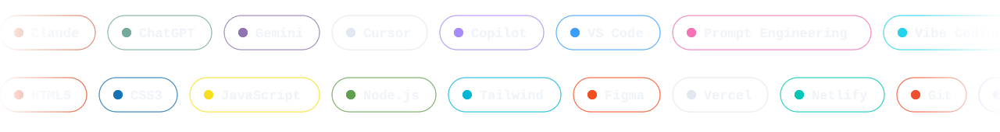

  
  
  
  
  
  
  
  


  

  <picture>
    <source media="(prefers-color-scheme: dark)" srcset="./assets/github-snake-dark.svg" />
    <source media="(prefers-color-scheme: light)" srcset="./assets/github-snake.svg" />
    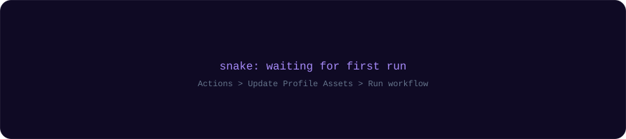
  </picture>

  <picture>
    <source media="(prefers-color-scheme: dark)" srcset="./assets/galaga-contribution-graph-dark.svg" />
    <source media="(prefers-color-scheme: light)" srcset="./assets/galaga-contribution-graph.svg" />
    
  </picture>


Saya terbuka untuk kolaborasi, proyek kreatif, dan diskusi seputar pengembangan web, AI tools, serta desain antarmuka. Silakan hubungi saya lewat tautan di bawah.

<!-- GANTI link di bawah dengan sosmed kamu (hapus tanda komentar kalau sudah siap)

  
  
  

-->

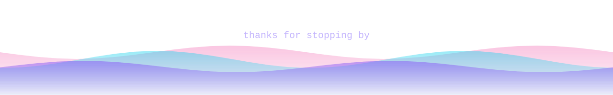
