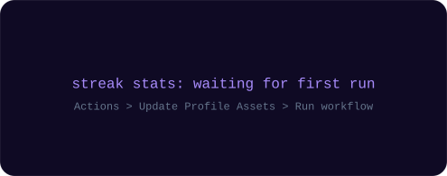
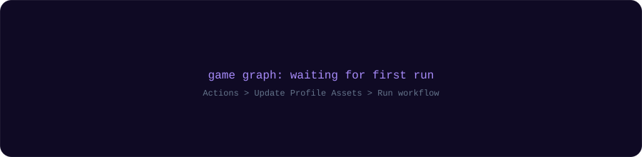

<p align="center">
  <b>Web Developer</b> &nbsp;•&nbsp; <b>UI/UX Enthusiast</b> &nbsp;•&nbsp; <b>Night Owl</b>
</p>

<p align="center">
  <a href="https://github.com/zikanooo"></a>
  
  
</p>

<!-- GANTI link di bawah dengan sosmed kamu (hapus tanda komentar kalau sudah siap)
<p align="center">
  <a href="https://instagram.com/USERNAME_KAMU"></a>
  <a href="https://t.me/USERNAME_KAMU"></a>
  <a href="mailto:EMAIL_KAMU"></a>
</p>
-->



## 👾 About Me

```js
const zychocuwek = {
  username: "zikanooo",
  role: "Web Developer",
  location: "Indonesia 🇮🇩",
  stack: ["HTML", "CSS", "JavaScript", "Node.js"],
  learning: ["TypeScript", "React", "System Design"],
  motto: "Code. Break. Fix. Repeat.",
};
```

## 🛠️ Tech Stack

<p align="center">
  
  
  
  
  
  
  
  
  
  
</p>

## 🚀 Currently Building

Membangun web app modern dengan fokus pada tampilan yang bersih, animasi halus, dan pengalaman pengguna yang nyaman.

## 📦 Featured Projects

<div align="center">

| Project | Bahasa | Stars | Update |
|:--|:--:|:--:|:--:|
| 🎵 [**MUSIFY**](https://github.com/zikanooo/MUSIFY) |  |  |  |
| ⚡ [**AMW**](https://github.com/zikanooo/AMW) |  |  |  |
| 🌐 [**AMP**](https://github.com/zikanooo/AMP) |  |  |  |
| 🧩 [**NMX**](https://github.com/zikanooo/NMX) |  |  |  |
| 🛠️ [**ANW**](https://github.com/zikanooo/ANW) |  |  |  |
| 📁 [**am**](https://github.com/zikanooo/am) |  |  |  |

</div>

## 📊 GitHub Stats

<p align="center">
  
</p>

<p align="center">
  <picture>
    <source media="(prefers-color-scheme: dark)" srcset="./assets/galaga-contribution-graph-dark.svg" />
    <source media="(prefers-color-scheme: light)" srcset="./assets/galaga-contribution-graph.svg" />
    
  </picture>
</p>


<p align="center"><sub>made with ☕ and too many tabs open · © zychocuwek</sub></p>
