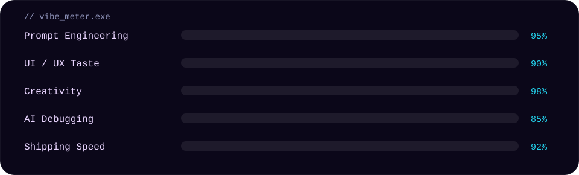
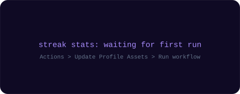
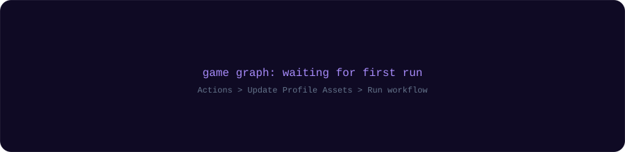

<p align="center">
  <b>Vibe Coder</b> &nbsp;•&nbsp; <b>AI-Powered Builder</b> &nbsp;•&nbsp; <b>UI/UX Lover</b>
</p>

<p align="center">
  <a href="https://github.com/zikanooo"></a>
  
  
</p>

<!-- GANTI link di bawah dengan sosmed kamu (hapus tanda komentar kalau sudah siap)
<p align="center">
  <a href="https://instagram.com/USERNAME_KAMU"></a>
  <a href="https://t.me/USERNAME_KAMU"></a>
  <a href="mailto:EMAIL_KAMU"></a>
</p>
-->



## 👾 About Me

```js
const zychocuwek = {
  username: "zikanooo",
  role: "Vibe Coder",
  location: "Indonesia 🇮🇩",
  superpower: "ngobrol sama AI sampai jadi produk",
  workflow: ["idea", "prompt", "iterate", "vibe", "ship"],
  motto: "Prompt. Vibe. Ship. Repeat.",
};
```

## ⚡ Vibe Workflow

<p align="center">
  
</p>

## 🎛️ Vibe Meter

<p align="center">
  
</p>

## 🧰 Vibe Toolkit

<p align="center">
  
  
  
  
  
  
</p>

<p align="center">
  
  
  
  
  
  
  
  
  
</p>

## 🚀 Currently Vibing

Meracik web dan tools modern bareng AI: ide jadi prompt, prompt jadi produk, dengan tampilan bersih dan animasi halus.

## 📊 Activity

<p align="center">
  
</p>

<p align="center">
  <picture>
    <source media="(prefers-color-scheme: dark)" srcset="./assets/galaga-contribution-graph-dark.svg" />
    <source media="(prefers-color-scheme: light)" srcset="./assets/galaga-contribution-graph.svg" />
    
  </picture>
</p>


<p align="center"><sub>vibe coded with ☕ and good energy · © zychocuwek</sub></p>
